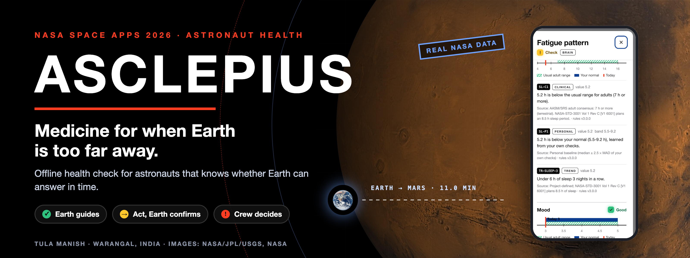
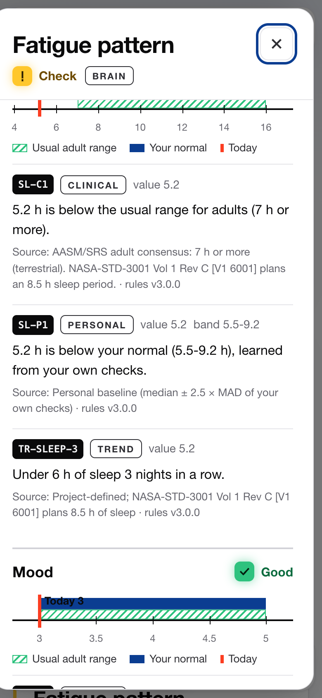
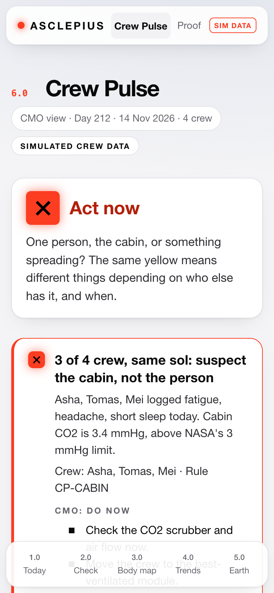
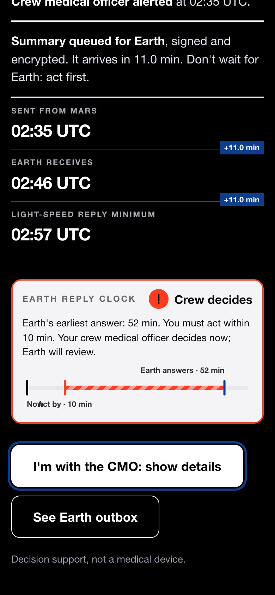
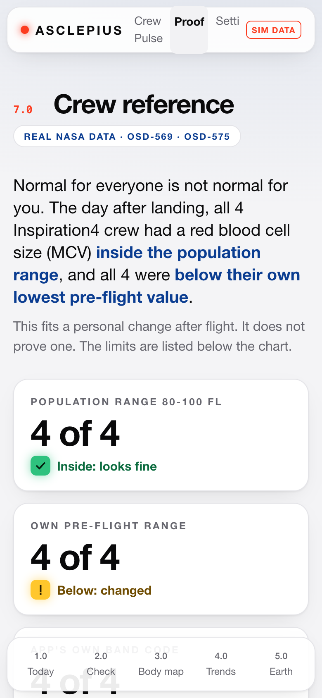
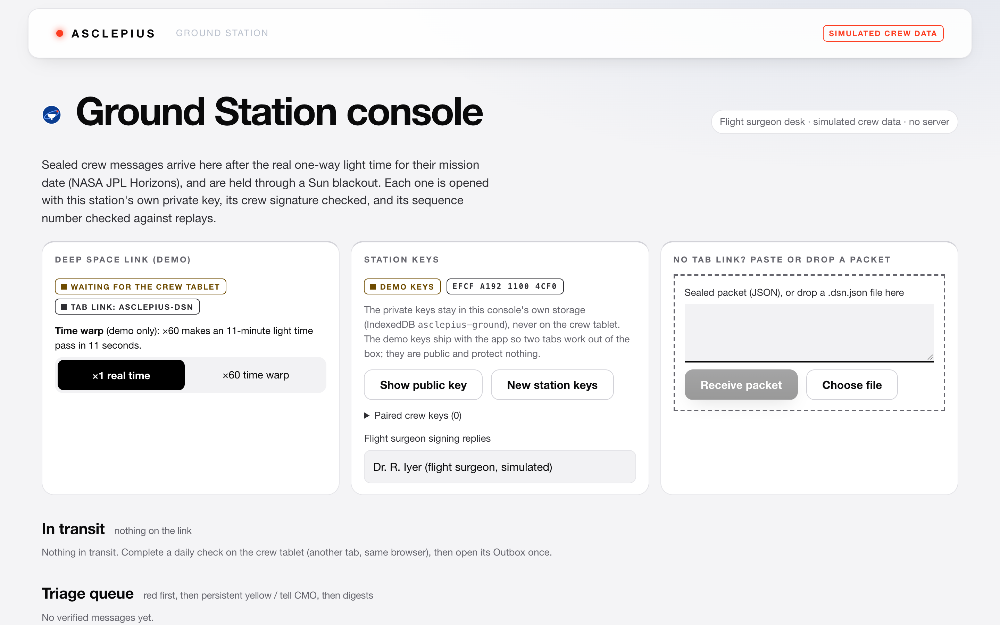
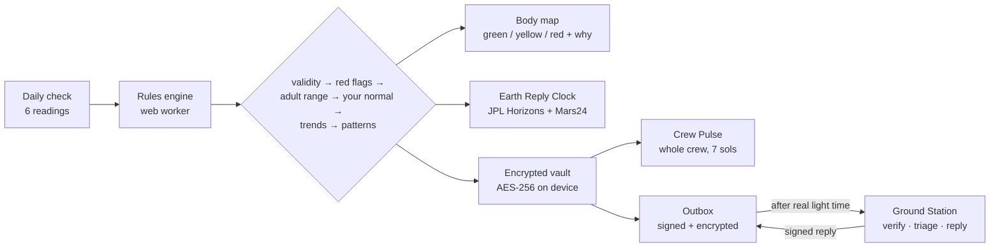

<p align="center">
  
</p>

<h1 align="center">ASCLEPIUS</h1>
<p align="center"><b>Medicine for when Earth is too far away.</b><br>
An offline health check for astronauts that knows whether Earth can answer in time.</p>

<p align="center">
  <a href="https://ibeastmanish.github.io/ASCLEPIUS/"><b>Live demo</b></a> ·
  <a href="https://ibeastmanish.github.io/ASCLEPIUS/ground.html"><b>Ground Station</b></a> ·
  <a href="pitch/ASCLEPIUS_SpaceApps2026_deck.pdf"><b>Pitch deck</b></a> ·
  <a href="docs/README.md"><b>Docs</b></a>
</p>

<p align="center">
  <a href="https://github.com/ibeastmanish/ASCLEPIUS/actions/workflows/ci.yml"></a>
  
  
  
  
</p>

<p align="center"><sub>NASA Space Apps Challenge 2026 · <i>Create Health Monitoring Software for Astronauts on Space Missions</i> · Tula Manish (Team ASCLEPIUS), Warangal, India</sub></p>

---

## The problem

On Mars, your doctor is on Earth.

- A radio message takes **4 to 22 minutes each way**: 11.0 minutes on 14 Nov 2026, from NASA JPL Horizons.
- In 2028 the Sun sits between Earth and Mars and the link goes **silent for 27 days** (8 Mar – 3 Apr).
- And "normal" is personal: a resting heart rate of **74** is fine for most adults, but a **warning sign** for an astronaut whose own normal is 52–62.

There is no doctor on board. The crew needs to know two things fast: *is this serious for me?* and *can Earth help in time?*

## What ASCLEPIUS does

Every morning the astronaut does a **one-minute check** of the six readings in the challenge: blood pressure, heart rate, blood sugar, temperature, sleep and mood. Each reading is judged twice, against the **usual adult range** and against **the astronaut's own learned normal**. The worse result wins. The answer appears on a clickable body map, in green, yellow or red, and every colour shows the rule and the NASA source behind it. **No AI makes health decisions.**

Then it does three things that, as far as we could find, no other entry or tool does:

### 1 · Earth Reply Clock: *can Earth answer before you must act?*
```
Earth's earliest answer = light time to Earth + flight surgeon's reply + light time back
```
That is compared with how soon the crew must act. The result is one of three levels:

| | When | Example (Mars, 14 Nov 2026) |
|---|---|---|
| 🟢 **Earth guides** | Earth answers well before you need to act | A yellow trend: Earth replies in about 1 h 22 min, you have a day |
| 🟡 **Act, Earth confirms** | Earth answers just in time | Start the steps, Earth confirms inside your window |
| 🔴 **Crew decides** | Earth answers too late, or the Sun blocks the link | Dangerously low blood sugar: Earth needs **27 min**, you have **10** |

The light time is real (NASA JPL Horizons, every day 2026–2029). Whether the flight surgeon in Houston is on shift is worked out from Mars time (NASA Mars24): a Mars day is 39.6 minutes longer than an Earth day, so the crew's morning drifts against Houston's clock. NASA's own *Earth-Independent Medical Operations* concept says decisions move to the crew when Earth is too far, but defines no levels. This gives it numbers.

### 2 · Crew Pulse: *one person, the cabin, or something spreading?*
The crew medical officer sees all four crew over the last seven days:
- **One person flagged** → it's about them.
- **Same complaint in 2+ crew, same day** → suspect the cabin. Cabin CO2 is checked against NASA's **3 mmHg** limit (NASA-STD-3001).
- **Fever moving from one person to the next, 1–3 days apart** → possible infection (NASA HRP: spaceflight can wake dormant viruses).
- **Whole crew sleeping under 6 h for 3 days** → a schedule problem.

Mood scores are never shown to anyone else.

### 3 · Proof on real NASA crew data, computed by the app itself
The app's own personal-range rule was run on **NASA OSDR OSD-569**, blood counts from the four Inspiration4 crew:

> The day after landing, **all 4 crew** had a red-cell size (MCV) **below their own lowest pre-flight value**, while **all 4** were still inside the 80–100 fL adult range.
> **Population range: 4 of 4 fine. Personal range: 4 of 4 changed.**

Along the way we found and fixed a **data error in the NASA file** and reported it to NASA ([details below](#a-data-error-we-found-in-nasas-file)).

### Plus
- **Ground Station console**: a second page for the flight surgeon. Messages arrive only after the real light time, the crew's signature is checked, replays are rejected, and the signed reply reaches the crew one light time later.
- **Delay is delay**: the same clock helps rural health workers near Warangal, using travel time to the doctor and clinic hours instead of light time. The daily check is available in Telugu (draft).

## Screens

<table>
  <tr>
    <td align="center" width="25%"><br><sub><b>Body map</b>: every colour shows its rule and source</sub></td>
    <td align="center" width="25%"><br><sub><b>Crew Pulse</b>: the cabin, not the person</sub></td>
    <td align="center" width="25%"><br><sub><b>Red alert</b>: Earth too late, crew decides</sub></td>
    <td align="center" width="25%"><br><sub><b>Proof</b>: NASA Inspiration4 data</sub></td>
  </tr>
</table>
<p align="center"><br><sub><b>Ground Station console</b>: the flight surgeon's side</sub></p>
<p align="center"><sub>All crew shown are simulated and labelled so in the app.</sub></p>

## Try it in 60 seconds
1. Open the **[live demo](https://ibeastmanish.github.io/ASCLEPIUS/)** on a phone or laptop. Choose any passphrase (8+ characters) and keep **Load the simulated crew member** ticked. You are Commander Asha Rao, Day 212 on Mars.
2. **Check** → heart rate **74**, sleep **5.2**, mood **3** → *Finish*. The body map turns yellow with a fatigue pattern; tap **Heart** → *Why this colour?*
3. Open **Crew Pulse**: 3 of 4 crew, same day, CO2 above NASA's limit → *suspect the cabin*.
4. Do a new check with blood sugar **48** → **Act now**. The Reply Clock says *crew decides*.
5. Open the **[Ground Station](https://ibeastmanish.github.io/ASCLEPIUS/ground.html)** in a second tab and switch on **×60 time warp**. The message arrives after the light time; write a reply, and the crew tab shows *Earth answered*.
6. *Settings → Mar 20, 2028* replays the Sun blackout: every finding becomes *crew decides*.

## How it works



- **One file of rules** (`src/engine/rules.json`): every threshold has an ID and a source. NASA-STD-3001 is used where it gives a number (sleep, CO2, hypothermia); named medical guidelines (ACC/AHA, ADA) where it doesn't, labelled as such.
- **Your normal** = median ± 2.5 × MAD of your first 7 checks. The median resists one odd reading. The band's width is then fixed, so a slow decline can't hide by becoming the "new normal".
- **No server, no internet** after the first load. Data is stored on the device and encrypted (AES-GCM 256; key from your passphrase via PBKDF2, 600,000 rounds).
- **Messages to Earth** are signed with the crew's key and encrypted to the ground station's public key. The tablet never holds Earth's private key, and each message carries a sequence number so replays are rejected.

<details>
<summary><b>The evaluation pipeline in detail</b></summary>

| Layer | What it does | Where |
|---|---|---|
| Validity | Impossible values are never coloured: "please re-measure" | `src/engine/evaluate.ts` |
| Red flags | Crisis values and warning signs are red at once and can't be skipped (e.g. BP < 80/40, glucose < 54, chest pain) | `rules.json` |
| Adult range | Usual ranges with sources; after-meal glucose has its own range | `rules.json` |
| Your normal | median ± 2.5 × scaled MAD, learned from 7+ checks; only the centre drifts (EWMA) from green checks | `src/engine/baseline.ts` |
| Trends | 3 short nights, 3 low-mood days, 3 days of raised HR, < 4 h sleep two nights running | `rules.json` |
| Patterns | One card instead of many alerts: fatigue, possible infection, dizzy on standing (orthostatic) | `src/engine/evaluate.ts` |
| Escalation | none → recheck → tell the medical officer → alert the officer + Earth. Patterns, multi-day trends and yellow on 3 of 5 days move a yellow up | `src/engine/escalate.ts` |
| Reply Clock | act-by window per rule vs earliest Earth answer (light time, blackout, surgeon shift, Mars-sol drift) | `src/engine/replyclock.ts` |
| Crew Pulse | one / cabin / spreading / sleep-debt rules across the crew | `src/engine/crewpulse.ts` |

Every result carries its *why*: rule ID, layer, value, band, source and rules version. The Ground Station receives exactly that snapshot, with a hash of the rule set.
</details>

## NASA data

| Source | Used for |
|---|---|
| **NASA JPL Horizons** (Mars from Earth, daily, Nov 2026 – Dec 2029) | Real light time for every date and the 2028 Sun blackout: drives the Reply Clock, outbox and Ground Station |
| **NASA GISS Mars24** | Mars local time and the sol drift against the surgeon's shift |
| **NASA OSDR OSD-569 / OSD-575** (Inspiration4 blood tests) | The proof: MCV in 4 of 4 crew; 16 of 34 markers better judged by a personal range |
| **NASA-STD-3001** Vol 1 Rev C, Vol 2 Rev F | Cited rule by rule: sleep, behavioural health, hypothermia, cabin CO2, orthostatic intolerance |
| **NASA OCHMO-TB-004** (carbon dioxide) | Headaches from 2.8 mmHg: the Crew Pulse cabin rule |
| **NASA HRP**: 5 Hazards, Risks of Human Spaceflight, Ongoing Research | Every card names its hazard and links the exact HRP risks (9 risks, 25 cards) |
| **NASA EIMO concept of operations** (NTRS 20250000009) | The idea the Reply Clock gives numbers to |
| **CSA**: Monitoring Radiation for Astronaut Health | Further reading on the radiation card |

Every downloaded file has its URL, fetch time, size and SHA-256 in [`data/manifest.json`](data/manifest.json).

### A data error we found in NASA's file
In OSD-569's CBC file, row `C003_whole-blood_L-92` is missing one value (MCH), so everything after it sits one column to the right. The row's own numbers prove it:

- **MCH = haemoglobin ÷ red cells** = 13.2 ÷ 4.46 × 10 = **29.6**, which is the number in the *MCHC* column.
- **Neutrophils = 71.1% × 9.6k white cells** = **6826**, which is the number in the *lymphocytes* column.

[`analysis/i4_proof.py`](analysis/i4_proof.py) detects the shift, moves 9 values back, checks the maths, and writes [`data/derived/cbc_corrected.csv`](data/derived/) with a [README](data/derived/README.md). NASA's original file is kept untouched. It was **reported to the NASA OSDR team on 13 Nov 2026**.

An earlier version of this project claimed "hidden lymphocyte drift in all 4 crew". That claim came from the shifted row, so it was **withdrawn**.

**Limits, stated in the app too:** 4 people, a 3-day flight, no tests during flight; MCV stayed low months later in 3 crew, so a lab change may be part of it. *Consistent with* a personal change, not proof of one.

## Run it yourself
```bash
git clone https://github.com/ibeastmanish/ASCLEPIUS.git
cd ASCLEPIUS
npm install
npm run dev          # https://localhost:5173 (self-signed; WebCrypto needs a secure context)
npm test             # 148 tests
npm run build        # dist/: crew app (index.html) + Ground Station (ground.html)
npm run proof        # rebuilds the NASA OSD-569 result from the raw files
```

<details>
<summary><b>Tests (148)</b></summary>

- Every rule at, just below and just above each threshold, driven from `rules.json` (schema-validated).
- Property tests (fast-check, thousands of random checks): invalid input is never coloured; the overall colour is never greener than any reading; a red flag is always red; any warning symptom makes the check red.
- Reply Clock: Mars red → *crew decides* (27 min vs 10); Moon → *Earth confirms*; the same finding changes level at 4 vs 22 min; blackout → always *crew decides*; Mars-sol drift; clinic mode.
- Crew Pulse: each pattern, plus the negatives (different days ≠ same day; 4 sols apart ≠ spreading; the same person twice ≠ spreading).
- Security: the crew key ring holds no ground private key; a one-bit change fails decryption; a changed **signed body** fails the **signature**; a forged key fails; a replayed sequence number is rejected; messages are held for the real light time and through the blackout.
- NASA data: the proof's invariants and the shift fix; every guidance card names a real HRP risk.
</details>

<details>
<summary><b>Repository layout</b></summary>

```
src/            the app: engine/ (rules, Reply Clock, Crew Pulse), screens/, ui/, storage/ (vault, crypto),
                ground/ (Ground Station), i18n/ (Telugu), seed/ (simulated crew)
index.html      crew tablet          ground.html   Ground Station console
analysis/       Python: NASA data processing and the OSD-569 proof
data/           raw/ (NASA downloads, untouched) · derived/ (corrected CBC) · manifest.json (provenance)
docs/           PRD, product brief, submission text, pre-event disclosure, translations
pitch/          deck (PDF, PPTX), speech, banners, script and Q&A, and their sources
src-tauri/      optional desktop build (Tauri + OpenPGP)
```
</details>

<details>
<summary><b>Optional desktop build</b></summary>

The same app as an installed program, with Earth messages signed and encrypted using OpenPGP via the team's earlier library `aura`. It needs that repository checked out next to this one, so it is not part of the judged submission.

```bash
npm run desktop:test       # Rust tests: round trip, tamper, forged signer, wrong passphrase
npm run desktop:build      # ASCLEPIUS.app + .dmg in src-tauri/target/release/bundle/
```
</details>

## Honest by design
- **Decision support, not a medical device.** ASCLEPIUS does not diagnose.
- **Simulated crew.** Commander Asha Rao and her crew are fictional, generated through the real engine and labelled on every screen.
- **Assumptions are labelled.** Houston shift hours, surgeon response times and act-by windows are shown in the app as assumptions.
- **Known limits:** blood pressure, heart rate and glucose thresholds are terrestrial guidelines awaiting a flight surgeon's review; the Telugu text is a draft; Crew Pulse runs on one device in the demo; the shipped Ground Station keys are demo keys (see [SECURITY.md](SECURITY.md)).
- **AI assistance.** AI coding assistants (Claude Code) helped research, write and test the code and draft the documents; those commits carry a `Co-Authored-By` line. The health rules, medical wording and data analysis were reviewed by the author. **No AI makes health decisions in the app.** No AI-generated images, video or audio are used.

## More
[Docs index](docs/README.md) · [PRD](docs/prd-v3.md) · [Submission text](docs/submission.md) · [Pre-event disclosure](docs/pre-event-disclosure.md) · [Changelog](CHANGELOG.md) · [Security](SECURITY.md) · [Pitch materials](pitch/README.md)

## Licence and credits
**MIT** (see [LICENSE](LICENSE)). Built with React, Vite, TypeScript, Dexie, Recharts, Workbox, Vitest and fast-check (MIT / Apache-2.0).
NASA data and documents are public: JPL Horizons, GISS Mars24, OSDR (OSD-569, OSD-575), NASA-STD-3001, OCHMO-TB-004, HRP, NTRS. Images: NASA, NASA/JPL/USGS.

<p align="center"><sub>Made in Warangal, India, by <b>Tula Manish</b> · NASA Space Apps Challenge 2026</sub></p>
